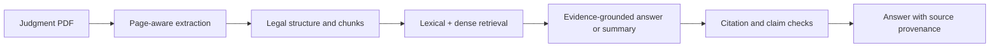

<div align="center">

# LegalSaarthi

### Evidence-grounded research for Indian Supreme Court judgments

LegalSaarthi is a research project and web application for exploring court judgments, asking evidence-backed questions, and producing structured or plain-language summaries with inspectable sources.

[Get started](#-get-started) · [Explore features](#-what-you-can-explore) · [Run tests](#-test-it) · [Read the docs](#-project-guide) · [Contribute](#-contributing)


</div>

> **Important:** LegalSaarthi is an experimental legal research aid, not legal advice. It is not a substitute for a lawyer or an official court-certified copy. Always verify legal information against the original judgment and authoritative sources.

<details>
<summary><strong>Contents</strong></summary>

- [At a glance](#-at-a-glance)
- [What you can explore](#-what-you-can-explore)
- [How it works](#-how-it-works)
- [Get started](#-get-started)
- [Test it](#-test-it)
- [Project guide](#-project-guide)
- [Research integrity and data](#-research-integrity-and-data)
- [Contributing](#-contributing)
- [License](#-license)

</details>

## 🔎 At a glance

The project investigates whether combining hybrid lexical and dense retrieval, legal-document structure, and citation/claim verification can improve factuality and citation correctness compared with generic LLM and basic RAG approaches.

The system is designed to keep evidence inspectable: answers and summaries can be traced to source material rather than treated as authoritative on their own. Research hypotheses and evaluation plans are documented in [`RESEARCH_SPEC.md`](RESEARCH_SPEC.md).

## ✨ What you can explore

<details open>
<summary><strong>Application capabilities</strong></summary>

- **Judgment documents:** upload and process a PDF, with page-aware extraction and document-scoped indexing.
- **Evidence-grounded Q&A:** search a selected document or the available corpus; inspect supporting passages and citations.
- **Structured summaries:** organize material around case facts, issues, reasoning, cited authorities, provisions, and disposition.
- **Plain-language summaries:** present judgment content in more accessible language while keeping evidence central.
- **Judgment explorer and search:** browse and search indexed case material when corpus data is configured.
- **Research and evaluation:** run retrieval and generation evaluations, comparisons, and ablations using the provided scripts.

</details>

> The code is published here; judgment PDFs, local databases, model files, and generated experiment runs are not bundled. Some application views therefore require you to acquire or configure data first.

## 🧭 How it works



The acquisition pipeline is deliberately separate from analysis. Metadata is resolved to a verifiable source, downloaded files are validated, and acquisition outcomes are recorded in a manifest. See the [runbook](RUNBOOK.md) before acquiring data.

## 🚀 Get started

### Requirements

- Windows, macOS, or Linux
- Python 3.10 or later
- Git
- Optional: [Ollama](https://ollama.com/) and a supported local model for local generation

### Install and launch

```powershell
git clone https://github.com/afzal-18-tech/LegalSaarthi.git
cd LegalSaarthi

python -m venv .venv
.\.venv\Scripts\Activate.ps1
python -m pip install --upgrade pip
python -m pip install -r requirements.txt

python -m uvicorn src.api.app:app --host 127.0.0.1 --port 8000
```

On macOS or Linux, activate the environment with `source .venv/bin/activate`.

Open [http://127.0.0.1:8000/](http://127.0.0.1:8000/) in a browser. Stop the local server with **Ctrl+C** in its terminal.

<details>
<summary><strong>Optional: configure a local language model</strong></summary>

Install Ollama, then download and start a model supported by your configuration, for example:

```shell
ollama pull qwen3:8b
ollama serve
```

Generation behavior depends on your local configuration and model availability. Do not put API keys or other credentials in tracked files.

</details>

## 🧪 Test it

Run the automated test suite from the repository root:

```shell
python -m pytest tests/ -q
```

The current local test suite contains 310 tests; results can vary with environment and dependency versions. The last run in the development workspace passed all 310 tests.

## 📚 Project guide

| Guide | What it covers |
|---|---|
| [Runbook](RUNBOOK.md) | Environment setup, staged acquisition gates, and troubleshooting |
| [Demo guide](DEMO_GUIDE.md) | Suggested application walkthrough |
| [Research specification](RESEARCH_SPEC.md) | Research question, hypotheses, and evaluation scope |
| [Implementation plan](IMPLEMENTATION_PLAN.md) | Project implementation outline |
| [Detailed implementation plan](LegalSaarthi_Final_Implementation_Plan.md) | Detailed project implementation outline |
| [Literature review](docs/literature/) | Research rationale and literature notes |
| [Source code](src/) | Application, ingestion, retrieval, and evaluation modules |
| [Scripts](scripts/) | Acquisition, processing, and evaluation commands |
| [Tests](tests/) | Unit and integration tests |

## 🔐 Research integrity and data

- Do not use the locked final test set for prompt, model, or component tuning.
- Preserve acquisition failures, source provenance, raw predictions, and experiment logs in local research storage.
- Do not treat metadata as a judgment document until the underlying source has been acquired and validated.
- Do not upload confidential client material or credentials.
- Review the applicable source and dataset terms before redistribution.

The public repository intentionally excludes local datasets, uploaded documents, user/session state, logs, caches, scratch work, and generated experiment artifacts. Follow [`RUNBOOK.md`](RUNBOOK.md) to acquire data locally and retain its manifests and provenance.

## 🤝 Contributing

Issues and pull requests are welcome. For changes to evaluation or research claims, include the configuration, data split, command, and reproducible evidence for the result. Do not report unverified metrics as findings.

## License

No repository license file is currently included. Unless and until one is added, all rights are reserved for this repository's original code. The upstream judgment dataset may have separate terms; check those terms before use or redistribution.
